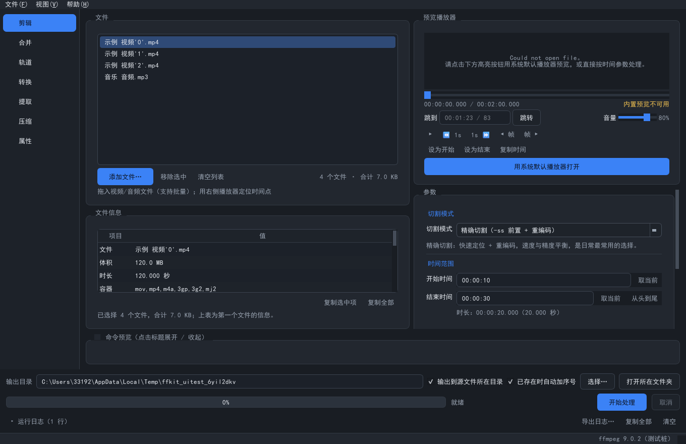
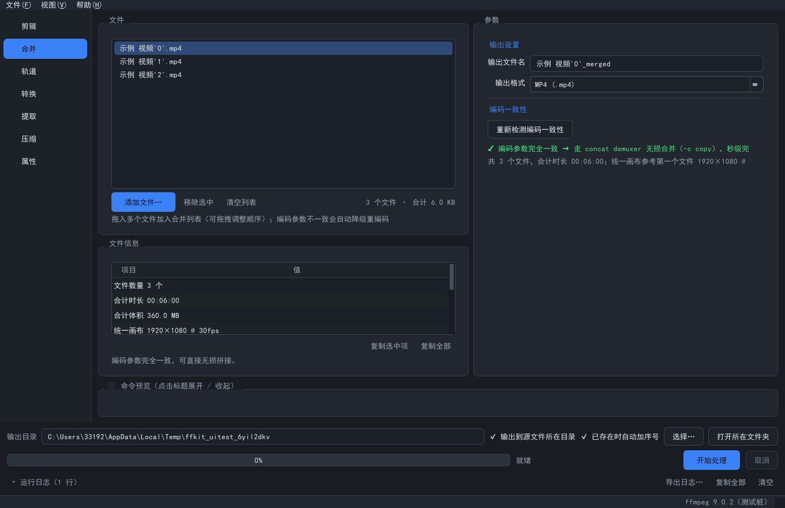
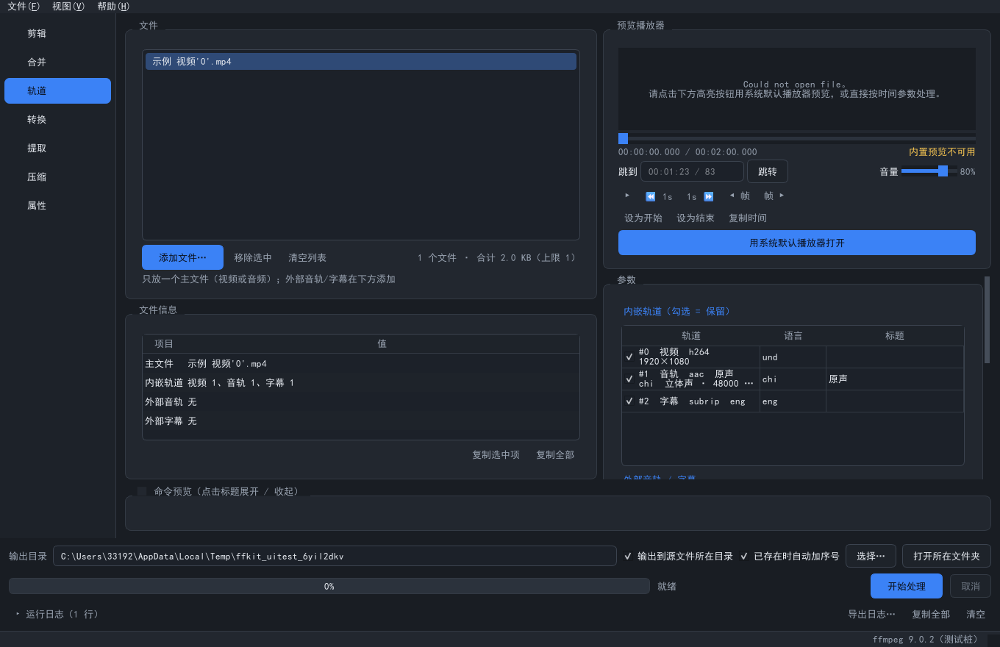
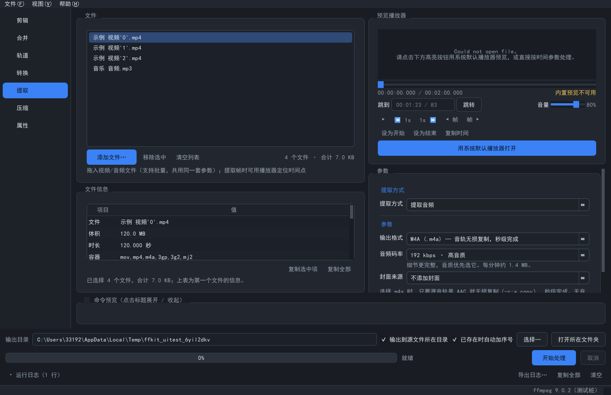
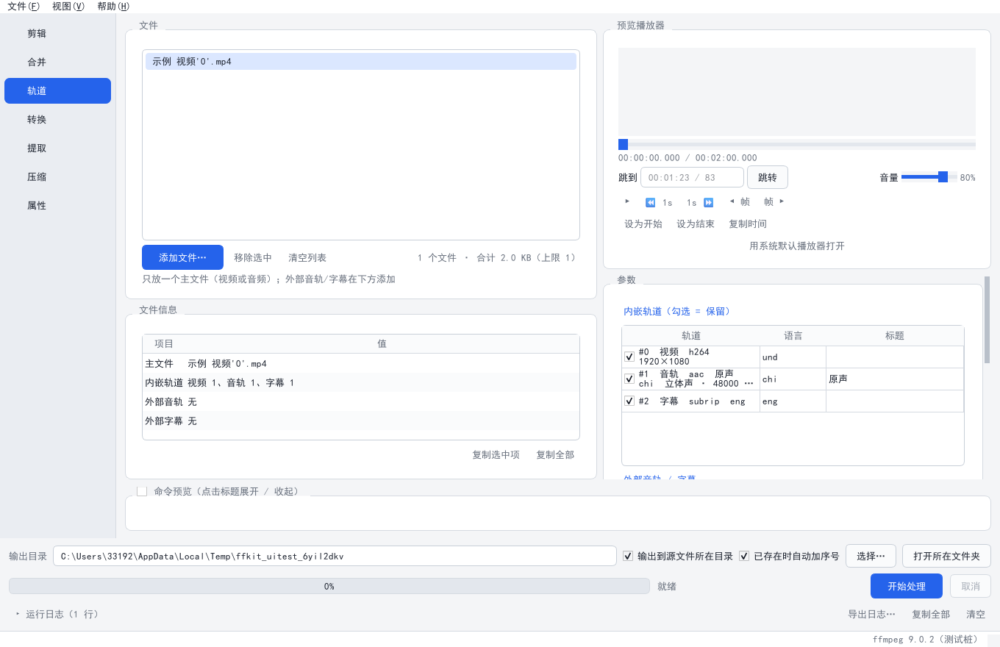

# FFKit

[](https://github.com/F-Yaohu/FFKit/actions/workflows/ci.yml)
[](https://github.com/F-Yaohu/FFKit/releases/latest)
[](LICENSE)
[](requirements.txt)

<p align="center">
  
</p>

<p align="center">
  <b>ffmpeg 的图形化外壳</b> —— 本地 · 离线 · 无广告 · 轻量
</p>

---

FFKit 是一个 Windows 桌面程序，把 ffmpeg/ffprobe 那些要记的命令行参数变成点几下就能完成的操作。
它**不内置 ffmpeg**，只负责生成正确的命令、调用本机已安装的 ffmpeg，并把过程可视化：
处理前的命令预览、实时进度、可随时取消、完成后告诉你体积变了多少。

定位很明确：**它是 ffmpeg 的外壳，不是替代品**。所有真正的编解码工作都由 ffmpeg 完成。

---

## 目录

- [功能](#功能)
- [界面](#界面)
- [快速开始](#快速开始)
- [下载](#下载)
- [设计取舍](#设计取舍)
- [运行架构](#运行架构)
- [开发与测试](#开发与测试)
- [打包](#打包)
- [常见问题](#常见问题)
- [许可](#许可)

---

## 功能

七个功能页，覆盖日常最常用的媒体处理场景。每个页面都能**批量处理**——把多个文件拖进去，
用同一套参数依次跑完。

### 剪辑

| 模式 | 说明 |
| --- | --- |
| 无损切割 | `-c copy`，秒级完成。切割点自动对齐到最近关键帧，最大偏差约一个 GOP 长度 |
| 精确切割 | 逐帧准确，速度与精度平衡 |
| 绝对精确 | `-ss` 后置 + 重编码，逐帧定位，适合要求严格对齐的场合 |
| 智能切割 | 只对首尾两小段重编码，中间走无损复制（LosslessCut 机制），兼顾速度与精度 |

内置预览播放器可以定位时间点，一键填入开始/结束时间或复制时间戳。支持拖入**文件夹**递归展开。

### 合并

先用 ffprobe 逐项比对各文件的编码参数（分辨率、编码、帧率、像素格式、采样率、声道数）：

- **参数一致** → concat demuxer 无损拼接，秒级完成
- **参数不一致** → 自动降级为 concat filter 重编码，较慢但必定成功

界面会明确标注本次走哪条路，并把差异逐条列出来（"第 2 个文件分辨率 1920×1080 ≠ 1280×720"）。
文件可拖拽调整顺序。

### 轨道（多轨封装）

与「合并」不同——合并是首尾**拼接**，轨道是把不同类型的轨道**装进同一个文件**，输出时长不变。

- 内嵌轨道可勾选保留/丢弃，支持挂多条音轨与字幕
- 外部音频/字幕文件可设置语言、标题、默认/强制标记
- 视频与兼容音轨无损 copy；容器装不下的编码（如 MP4 里的 FLAC、srt）自动转换并提示

### 转换

输出格式：MP4 / MKV / MP3 / WAV / M4A / FLAC。

- 参数按「输出格式 / 音频 / 画面」分组，选到纯音频容器时整个画面组自动隐藏，命令不会带任何视频参数
- **容器与音频编码联动**：MP4 里塞 MP3、WAV 里塞 AAC 这类播放器认不出的组合被彻底禁止。
  界面下拉选项与命令构建共用同一张映射表，"界面上能选的"和"命令里真正生成的"永远一致
- 画面参数：分辨率（预设/自定义）、帧率、编码器、CRF / 码率、编码速度、旋转与翻转
- 音量调整（100% 为保持原样）

### 提取

| 子功能 | 说明 |
| --- | --- |
| 提取音频 | m4a/aac 在源音轨为 AAC 时**无损 copy，秒级完成**；mp3/wav/flac 按需重编码 |
| 提取音频 + 封面 | 可选择「取源视频开头画面」或「取自定义时间点」，批量时每个文件按**各自的时长**检查边界 |
| 去音频 | `-an -c:v copy`，视频流不重编码，秒级完成 |
| 提取某一帧为图片 | 默认取当前预览时间，无预览时取时长 10%；支持秒数与百分比两种输入；可选 JPG/PNG 与最大宽度 |

### 压缩

- 视频压缩：x264 / x265 三档预设（画质优先 / 推荐 / 体积优先）
- 「目标体积 MB」模式：两遍编码反推码率，耗时约为单遍的 2 倍
- **压缩前显示源码率**：码率本就偏低时会提示"继续压缩收益有限且画质损失明显"
- **压缩完成后显示前后体积对比**
- 音频压缩：MP3 / M4A / FLAC / WAV，容器与编码自动联动

### 属性

- **封面**：设置 / 更换 / 移除。加入文件后自动读取内嵌封面并显示缩略图，可一键「沿用原封面」
- **文件属性**：标题、艺术家、专辑、年份、流派、备注、季集号等；加入文件时自动带出已有属性
- 全程 `-c copy`，只改容器头，音视频流不重编码

---

## 界面

<p align="center">
  
</p>

<p align="center">
  
</p>

<p align="center">
  
</p>

<p align="center">
  
</p>

<p align="center">
  
</p>

---

## 快速开始

### 从源码运行

需要 Python 3.10+。

```bat
:: 1) 安装依赖
pip install -r requirements.txt

:: 2) 安装 ffmpeg（任选其一）
winget install Gyan.FFmpeg
:: 或
scoop install ffmpeg
:: 或到 https://www.gyan.dev/ffmpeg/builds/ 下载，把 bin 目录加入 PATH

:: 3) 运行
python main.py
```

**没有 ffmpeg 也能打开程序**——顶栏会出现提示条，可以点「手动指定 ffmpeg…」或在
「文件 → 首选项」里填 `ffmpeg.exe` 路径（会记住，下次启动直接生效）。

## 下载

Releases 页提供 Windows 64 位免安装压缩包，解压后直接运行 `FFKit.exe`。

> 压缩包内**不含 ffmpeg**，需要本机已安装并加入 PATH。

---

## 设计取舍

这个项目里有几处刻意的选择，值得说明：

### 命令预览可见、可编辑

底部有一个默认折叠的命令框，实时显示**将要执行的完整 ffmpeg 命令**。
它是只读的，但可以勾选"允许编辑"——改完直接按原样执行。

这解决了一个实际问题：图形界面不可能覆盖 ffmpeg 的全部能力。
与其让用户卡在"这个选项界面里没有"，不如把命令摊开，让他自己写。
编辑过的命令会降级执行（无进度条、不校验输出路径），界面会明确提示。

### 输出永远走临时文件 + 原子重命名

输出先写成 `xxx.mp4.tmp`（显式 `-f` 指定 muxer），成功后才 `os.replace` 成正式名。

任何时候中断或失败，都不会留下一个"看起来正常、其实是半个"的损坏文件。

### 自动降级而不是报错

很多地方会主动帮用户兜底：

- 合并时编码不一致 → 自动降级重编码（而不是拒绝执行）
- MP4 里放不下 MP3 → 自动换 AAC 并在说明里讲清原因
- 压缩时源码率本来就低 → 提示不建议压缩
- 系统禁止 QProcess 走管道 → 自动切换为文件重定向模式
- 提取音频时选 WAV 却要封面 → 明确告警并降级为只提音频

原则是：**能办成就办成，但绝不悄悄改变结果**——每次降级都要在界面和命令预览里说明。

### 不能批量处理的页面会拦住

「轨道」页一次只处理一个主文件。这是硬约束，不是提示——
拖入 3 个文件时，界面会明确告诉你"已忽略额外的 2 个"，而不是默默只跑第一个。

### 面向普通用户的参数

音频码率这类参数没有用裸数字输入框，而是给了带说明的标准档位：

```
96 kbps · 语音/旁白     人声播客有声书，体积最小；音乐会发闷。每分钟约 0.7 MB
128 kbps · 通用标准     兼容性最好，日常首选。每分钟约 0.9 MB
192 kbps · 高音质       细节更完整，音质优先选它。每分钟约 1.4 MB
```

选 WAV / FLAC 这类无损输出时，码率控件会收起并说明原因，而不是留一个无意义的数字框。

---

## 运行架构

```
OperationSpec ──► Validator ──► CommandBuilder ──► Runner(QProcess) ──► CommandBox
  (做什么)        (能不能做)       (唯一 argv 出口)     (异步+进度+取消)      (命令预览)
```

| 模块 | 位置 | 职责 |
| --- | --- | --- |
| 配置持久化 | `app/config.py` | JSON，`%APPDATA%/FFKit/config.json` |
| 工具链定位 | `app/ffmpeg_locator.py` | PATH → 用户指定 → 常见目录；版本检测 |
| 元信息解析 | `app/core/prober.py` | ffprobe JSON 解析 + 缓存 + 一致性比对 + 关键帧扫描 |
| 校验层 | `app/core/validator.py` | 区分**全局错误**（中断队列）与**单文件错误**（跳过） |
| 命令构建 | `app/core/builder.py` | **全项目唯一生成 argv 的地方** |
| 异步执行 | `app/core/runner.py` | QProcess 信号驱动、进度解析、取消、临时文件清理 |
| 批量队列 | `app/core/queue.py` | 顺序执行、失败策略、结束汇总 |
| 界面 | `app/ui/**` | 主窗口 + 7 个功能页 + 通用组件 |

### 关键约定

- 子进程一律用 **argv 列表**，绝不 `shell=True`，绝不拼命令字符串
- 一律 `-y -nostdin -progress pipe:1 -nostats`；进度走 stdout，stderr 只做日志
- 输出先写 `.tmp` 再 `os.replace` 原子重命名
- concat 列表 UTF-8 **无 BOM**、单引号正确转义、调用时 `-safe 0`
- stderr 按系统 locale 解码 + `errors='replace'`，中文系统 GBK 输出不会炸
- 时长统一用 `-t` 而非 `-to`；时间输入支持 `00:01:23` / `01:23` / `83`
- 拖到**合并页** = 加入可排序列表；拖到**其他页** = 加入批量队列
- 不给 ffmpeg 传裸扩展名，所有 muxer 由 `paths.py` 的映射表推导

---

## 开发与测试

三套测试，都可以直接跑：

```bat
python selftest.py     :: 核心层自检（不需要 ffmpeg、不需要 GUI）
python uitest.py       :: GUI 冒烟测试（需要 PySide6，可用 QT_QPA_PLATFORM=offscreen）
python realtest.py     :: 真实媒体全链路（需要本机 ffmpeg，会真正执行转码/封面/元数据/多轨封装）
```

`uitest.py` 会在 `screenshots/` 下生成各功能页的深/浅色截图。

> `realtest.py` 从环境变量 `FFMPEG_DIR` 读取 ffmpeg 目录，未设置时会因为找不到
> `ffmpeg.exe` 而在样本生成阶段失败，后续报错具有误导性。
> ```bat
> set FFMPEG_DIR=D:\tools\ffmpeg-9.0.2-essentials_build\bin
> python realtest.py
> ```

### 目录结构

```
FFKit/
├── main.py                  # 入口
├── selftest.py              # 核心层自检
├── uitest.py                # GUI 冒烟测试
├── realtest.py              # 真实媒体全链路测试
├── requirements.txt
├── requirements_v2.md       # 需求文档（本实现的依据）
├── FFKit.spec               # PyInstaller 打包配置
├── assets/                  # logo 与图标（需随程序分发）
│   ├── logo.svg             #   正方形矢量版（唯一设计源文件）
│   ├── logo.png
│   ├── logo-horizontal.svg  #   横版矢量
│   ├── logo-horizontal.png
│   └── logo.ico             #   Windows 图标（16~256 多尺寸）
├── tools/
│   ├── render_logo.py       # 从 SVG 重新导出 PNG/ICO
│   └── build.py             # 一键打包
├── app/
│   ├── resources.py         # 资源定位与图标加载
│   ├── config.py            # 配置持久化
│   ├── ffmpeg_locator.py    # ffmpeg/ffprobe 定位与版本检测
│   ├── core/                # 核心层（与 UI 解耦，可独立测试）
│   │   ├── spec.py          #   OperationSpec / Step / Job
│   │   ├── prober.py        #   ffprobe 元信息解析
│   │   ├── validator.py     #   校验层
│   │   ├── builder.py       #   CommandBuilder（唯一 argv 出口）
│   │   ├── runner.py        #   QProcess 异步执行
│   │   ├── queue.py         #   批量队列
│   │   ├── paths.py         #   路径/临时文件/concat 转义/命令渲染
│   │   ├── timeparse.py     #   时间解析与格式化
│   │   └── proc_util.py     #   子进程封装
│   └── ui/
│       ├── main_window.py   # 主窗口
│       ├── context.py       # AppContext
│       ├── dialogs.py       # 首选项对话框
│       ├── theme.py         # 深浅色 QSS
│       ├── widgets/         # 文件列表/信息面板/日志/命令框/预览播放器/参数组件
│       └── pages/           # 剪辑/合并/轨道/转换/提取/压缩/属性
└── screenshots/             # 各功能页界面截图
```

---

## 打包

```bat
pip install pyinstaller
python tools/build.py
```

产物在 `dist/FFKit/FFKit.exe`。

> **为什么用 `tools/build.py` 而不是直接 `pyinstaller FFKit.spec`？**
>
> PyInstaller 有个坑：`--icon` 指向的 ico 路径**包含非 ASCII 字符（例如中文目录）时会静默失败**——
> 日志照样打印 `Copying icon to EXE`，实际写入的却是它自带的默认图标，很难察觉。
> `tools/build.py` 会先把 `logo.ico` 复制到 ASCII 临时目录再传给 `--icon`，
> 并在打包结束后用 Win32 API 读回 exe 的图标像素做校验，确保图标真的是 FFKit 的。

若你的项目路径是纯 ASCII，也可以直接用：

```bat
pyinstaller --noconfirm FFKit.spec
```

重新生成图标：只改 `assets/logo.svg`，然后 `python tools/render_logo.py`。

---

## 常见问题

**Q：提示"未检测到 ffmpeg / ffprobe"？**
本工具不内置 ffmpeg。安装后确认 `ffmpeg` 与 `ffprobe` 都在 PATH 里，
或点顶栏的「手动指定 ffmpeg…」直接填 `ffmpeg.exe` 路径。

**Q：转换/压缩很慢？**
需要重编码的操作本来就是 CPU 密集型。可以试着：
- 编码速度从 `medium` 调到 `veryfast`（体积略增）
- 剪辑时用「无损切割」而不是「精确切割」
- 提取音频时选 m4a（源音轨是 AAC 时是无损 copy，秒级完成）

**Q：为什么"合并"有时会变成重新编码？**
合并只在所有文件的编码参数**完全一致**时才能无损拼接。
分辨率、编码、帧率、像素格式、采样率、声道数任一不同都会触发重编码，
界面会在合并前明确列出差异。

**Q：能批量处理吗？**
剪辑、提取、转换、压缩、属性页都支持批量，拖进去依次处理。
「轨道」页一次只处理一个主文件——拖多了会明确提示忽略了哪些。

**Q：会覆盖原文件吗？**
不会。所有输出都写到新文件（`原名_处理后缀.扩展名`），默认在源文件所在目录，
可在底部改成统一输出目录。已存在同名文件时默认自动加序号。

---

## 许可

[MIT](LICENSE) © FFKit contributors

本项目调用 ffmpeg 进行实际处理，**不包含、不分发 ffmpeg 本身**。
ffmpeg 的许可请参见 [ffmpeg.org](https://ffmpeg.org/legal.html)。